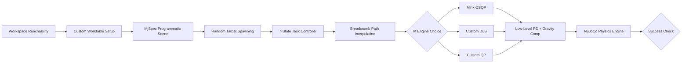

# Lab 03: Autonomous Pick-and-Place via Differential Inverse Kinematics (HEAL & Franka Panda)

An end-to-end physics-based manipulation pipeline built with [MuJoCo](https://mujoco.org/). This project evaluates and benchmarks **Differential Inverse Kinematics (IK)** solvers operating on both a 6-DOF industrial manipulator (Addverb HEAL) and a 7-DOF collaborative redundant manipulator (Franka Emika Panda), each fitted with a Robotiq 2F-85 adaptive parallel-jaw gripper.

---

## Technical Highlights & Video Demos

All experimental trials, solver evaluations, and boundary conditions are recorded on YouTube:

| Robot Platform | Inverse Kinematics Solver | Video Link | Key Observations |
|---|---|:---:|---|
| **6-DOF HEAL Arm** | **Mink (Baseline OSQP)** | [Watch Demo](https://youtu.be/h-dL-vL3UDM?si=1semsxsM4L094ZeF) | Baseline OSQP optimization with continuous distance collision bounds. |
| **6-DOF HEAL Arm** | **Custom Damped Least Squares (DLS)** | [Watch Demo](https://youtu.be/FMAL-rnbg08?si=yBDw17tpFTI-orKf) | Analytical Levenberg–Marquardt execution with **2.5× faster** planning speeds. |
| **6-DOF HEAL Arm** | **Custom Quadratic Programming (QP)** | [Watch Demo](https://youtu.be/oaHxvoVMIUw?si=IdQEXkaOgRmZANhr) | Strict joint position and velocity bound enforcement via `daqp`. |
| **7-DOF Franka Panda** | **Custom DLS Edge-Case Diagnostic** | [Watch Demo](https://youtu.be/ERtZ837I5WE) | Analysis of redundant null-space elbow posture causing minor tray wall contact. |

---

## Table of Contents

- [System Architecture](#system-architecture)
- [Worksurface Design & Workspace Analysis](#worksurface-design--workspace-analysis)
- [Programmatic Scene Construction](#programmatic-scene-construction)
- [7-Phase Task Control Engine](#7-phase-task-control-engine)
- [IK Solvers & Trajectory Conditioning](#ik-solvers--trajectory-conditioning)
- [Benchmarking & Performance Metrics](#benchmarking--performance-metrics)
- [Diagnostics & Engineering Safeguards](#diagnostics--engineering-safeguards)
- [Repository Structure](#repository-structure)
- [How to Run](#how-to-run)

---

## System Architecture

The simulation system executes autonomous pick-and-place trials in randomized environments:
- **Evaluated Kinematic Chains:**
  - **Addverb HEAL (6-DOF):** Standard industrial serial robot ($J(q) \in \mathbb{R}^{6 \times 6}$) featuring localized unique solutions away from singular points (`single_arm_heal_effort_actuation_rs_mj.xml`).
  - **Franka Emika Panda (7-DOF):** Redundant collaborative arm ($J(q) \in \mathbb{R}^{6 \times 7}$) possessing a 1D null space for secondary posture projection (`panda_nohand.xml`).
- **End-Effector Integration:** Robotiq 2F-85 parallel-jaw gripper programmatically mounted using MuJoCo's `MjSpec` API.
- **IK Solvers:** Mink (OSQP), Closed-Loop Damped Least Squares (DLS), and Box-Constrained Quadratic Programming (QP).
- **Low-Level Control:** Joint PD loop backed by gravity compensation feedforward (`qfrc_bias`), real-time clearance monitoring (`mj_geomDistance`), and bilateral contact verification.



---

## Worksurface Design & Workspace Analysis

Standard tables often restrict arm reachability or induce collisions with the base turret. Monte Carlo sampling (`table_design.py`) was used to derive an optimized worksurface for top-down manipulation.

### Table Geometry & Constraints

| Metric | Dimension | Design Rationale |
|---|---|---|
| **Surface Height** | **0.20 m** | Position target objects ($z \approx 0.36\text{ m}$) directly inside the high-manipulability region. |
| **Footprint ($X \times Y$)** | **0.34 m × 0.60 m** | Matched to the dexterous envelope ($x \in [0.24, 0.58]$, $y \in [-0.30, 0.30]$). |
| **Base Offset** | **0.41 m** | Center placed in the $+X$ working area to preserve a 0.18 m clearance around the robot base. |
| **Surface Thickness** | **0.04 m** | Rigid surface supported by floor-mounted legs ($z = 0.00\text{ m}$). |

---

## Programmatic Scene Construction

The environment is assembled dynamically at launch via the `MjSpec` framework (`scripts/env_pick_place.py` and `scripts_franka/env_pick_place.py`).

- **Manipulator Assemblies:** 6-DOF HEAL and 7-DOF Franka Panda initialized with joint torque interfaces and gravity compensation.
- **Gripper Attachment:** Robotiq 2F-85 attached to the terminal flange (`right_center` / `attachment_site`) via `MjSpec.attach()`.
- **Target Block:** 5 cm cube ($0.05\text{ m}$, 80 g) randomly placed on the $+Y$ surface ($x \in [0.30, 0.50]$, $y \in [0.06, 0.22]$) with random yaw $\psi \in [-\pi, \pi]$.
- **Receptacle Tray:** 12 cm × 12 cm green tray with 1.5 cm retaining walls positioned at $(0.41, -0.12)\text{ m}$.

---

## 7-Phase Task Control Engine

A deterministic finite state machine controls the execution cycle:

$$\text{APPROACH} \longrightarrow \text{DESCEND} \longrightarrow \text{GRASP} \longrightarrow \text{LIFT} \longrightarrow \text{TRANSIT} \longrightarrow \text{LOWER} \longrightarrow \text{RELEASE}$$

1. **`APPROACH`:** Position the end-effector over the block at $z_{approach} = z_{table} + 0.12\text{ m} + \Delta z_{ee}$ with top-down alignment.
2. **`DESCEND`:** Lower the gripper vertically to the target grasp elevation ($z_{grasp} = z_{table} + 0.035\text{ m} + \Delta z_{ee}$).
3. **`GRASP`:** Close gripper pads while maintaining arm position until bilateral force sensors confirm contact ($F_L, F_R \ge 0.5\text{ N}$).
4. **`LIFT`:** Ascend vertically to $z_{lift} = z_{table} + 0.15\text{ m} + \Delta z_{ee}$ to verify secure object attachment.
5. **`TRANSIT`:** Move horizontally across the workspace to a target point above the receiving tray.
6. **`LOWER`:** Lower the block into the tray footprint ($z_{place} = z_{table} + 0.035\text{ m} + \Delta z_{ee}$).
7. **`RELEASE`:** Open gripper jaws completely and retreat upward while verifying the block is stable and detached.

---

## IK Solvers & Trajectory Conditioning

### Path Interpolation & Error Bounding
To avoid velocity spikes during large Cartesian movements:
1. **Way-Point Trajectory Generation:** Trajectories are split into small steps using a constant linear speed $v_{move} = 0.03\text{ m/s}$:
   $$p_d(\alpha_i) = p_{start} + \alpha_i (p_{target} - p_{start}), \quad q_d(\alpha_i) = \text{SLERP}(q_{start}, q_{target}, \alpha_i)$$
2. **Error Saturation:** Task-space tracking error $e \in \mathbb{R}^6$ is bounded by $e_{max} = 0.02\text{ m/rad}$:
   $$\bar{e} = e \cdot \min\left(1, \, \frac{e_{max}}{\|e\|_2}\right)$$

### Solver Implementations

1. **Mink (OSQP Baseline):**
   Formulates differential IK as a configuration space quadratic program with joint and collision constraints:
   $$\min_{\Delta q} \frac{1}{2} \| J(q) \Delta q - e_x \|_W^2 + \frac{1}{2} \| \Delta q \|_{R}^2$$

2. **Damped Least Squares (DLS):**
   Uses Levenberg–Marquardt regularized pseudoinverse for singularity robustness:
   $$\dot{q}_{task} = \left( J^T J + \lambda I_n \right)^{-1} J^T \dot{x}_d$$
   For the 7-DOF Franka Panda, a null-space projection term is included for posture control:
   $$\dot{q} = \dot{q}_{task} + \left( I_n - J_{DLS}^\dagger J \right) k_{null} (q_{def} - q)$$

3. **Constrained Quadratic Programming (QP):**
   Solves an explicit quadratic program subject to velocity bounds:
   $$\min_{\dot{q}} \frac{1}{2} \dot{q}^T (J^T J + \lambda I) \dot{q} - (J^T \dot{x}_d)^T \dot{q} \quad \text{s.t. } l \le \dot{q} \le u$$

---

## Benchmarking & Performance Metrics

Evaluations were conducted across manipulators using fixed random seeds (`--seed 19`).

### 6-DOF Addverb HEAL (250 Episodes)

| Solver | Success Rate | Mean Planning Time (s) | Mean Total Time (s) | Min Clearance (mm) |
|---|:---:|:---:|:---:|:---:|
| **Mink (Baseline)** | **100.0%** | 0.7526 s | 9.1484 s | 1.388 mm |
| **Custom DLS** | **100.0%** | **0.2991 s** (⚡ 2.5× faster) | **8.5118 s** | **1.573 mm** |
| **Custom QP** | **100.0%** | 0.5851 s (⚡ 1.3× faster) | 9.1510 s | **1.573 mm** |

### 7-DOF Franka Emika Panda (30 Episodes)

| Solver | Success Rate | Mean Planning Time (s) | Mean Total Time (s) | Min Clearance (mm) |
|---|:---:|:---:|:---:|:---:|
| **Mink (Baseline)** | **100.0%** | 1.229 s | **206.59 s** | **+1.580 mm** |
| **Custom DLS** | 93.33% | **1.166 s** | 272.77 s | -0.031 mm (grazing) |
| **Custom QP** | 96.67% | 1.275 s | 246.17 s | -0.025 mm (grazing) |

---

## Diagnostics & Engineering Safeguards

1. **Gripper Linkage Clearance Offset:** Adding a $+1.0\text{ cm}$ elevation offset to $z_{grasp}$ prevented the bottom follower linkage (`geom71`) from scraping the table plane during finger closure.
2. **Tray Wall Contact Prevention:** Lowering position tolerance (`POS_TOL`) from 5 mm to 2 mm ensured centered object placement, avoiding outer pad contact with tray edges during release.
3. **Null-Space Posture Stabilization:** Setting $k_{null} = 0.5$ stabilized redundant 7-DOF arm postures without overriding end-effector tracking.

---

## Repository Structure

```
Lab_3/
├── README.md                  # Lab documentation
├── heal_pick_place.xml        # Main MuJoCo scene environment file
├── table_design.py            # Table geometry analysis script
├── table_design.json          # Exported table parameters
├── figures/                   # Workspace cross-sections & plots
├── scripts/                   # 6-DOF HEAL control scripts & solvers
│   ├── env_pick_place.py      # Scene setup generator (HEAL)
│   ├── ik_pick_place.py       # Mink IK execution
│   ├── ik_dls_pick_place.py   # DLS IK execution
│   ├── ik_qp_pick_place.py    # QP IK execution
│   └── plot_results.py        # Benchmark plotting script
├── robot_descriptions/        # Robot URDF/XML descriptions & meshes
└── utils/                     # Custom velocity control utilities
```

---

## How to Run

### Interactive GUI Simulation
```bash
# Run 6-DOF HEAL arm solvers:
python3 scripts/ik_pick_place.py          # Mink
python3 scripts/ik_dls_pick_place.py      # DLS
python3 scripts/ik_qp_pick_place.py       # QP
```

### Headless Benchmarking
```bash
# Run multi-episode benchmarks:
python3 scripts/ik_pick_place.py --episodes 25 --seed 19 --no-gui
python3 scripts/ik_dls_pick_place.py --episodes 25 --seed 19 --no-gui
python3 scripts/ik_qp_pick_place.py --episodes 25 --seed 19 --no-gui
```